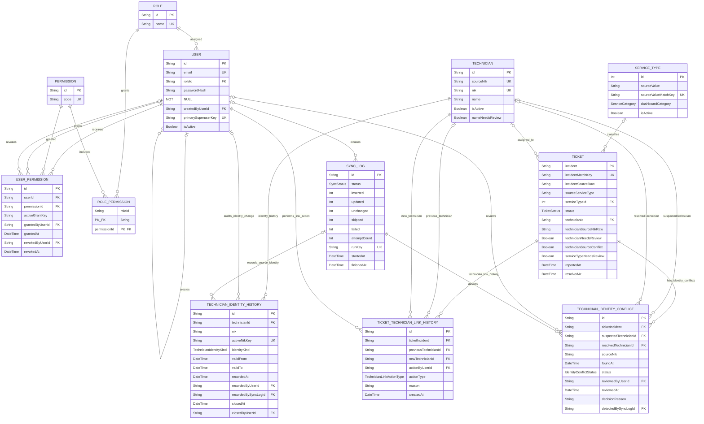

# Database Design — Prisma ORM / MySQL

Dokumen ini mencatat rancangan dan persiapan schema. Dependency Prisma
6.19.0 dan `prisma/schema.prisma` telah disiapkan; migration, database, API,
kode aplikasi, dan proses sinkronisasi belum dibuat atau dijalankan.

## Dasar rancangan

- Next.js 15.5.29 App Router, TypeScript `^5`, MySQL 8.0, Prisma dan
  `@prisma/client` 6.19.0.
- Prisma 6.19.0 terpasang dan Client berhasil digenerate dengan Next.js
  15.5.29 serta TypeScript 5.x; tidak ada perubahan versi dependency langsung
  lain. Ini bukan verifikasi koneksi atau kompatibilitas server MySQL.
- Google Sheets `MainSheet` adalah sumber READ-ONLY.
- Waktu sumber ditafsirkan dalam `Asia/Jakarta`, dikonversi ke UTC sebelum
  disimpan sebagai MySQL `DATETIME(3)`. MySQL `DATETIME` tidak menyimpan zona.
- Minimalkan PII pelanggan: rancangan inti tidak menyimpan nama/ID pelanggan,
  telepon, email, nomor layanan, serial perangkat, atau teks bebas pelanggan.
- NIK teknisi resmi hanya 4-8 digit ASCII (`^[0-9]{4,8}$`), disimpan sebagai
  String/VARCHAR(64), case-sensitive, dan mempertahankan nilai persis termasuk
  leading zero; tiket mereferensikan teknisi menggunakan UUID internal.

## ERD



Setiap `User` wajib memiliki tepat satu `Role` melalui `User.roleId`; tidak ada
tabel `UserRole`. Role dapat diberikan kepada banyak user. Permission efektif
berasal dari gabungan `RolePermission` dan grant aktif di `UserPermission`.
`User.createdByUserId` adalah relasi self-reference untuk pembuat akun.
`TechnicianIdentityHistory` menyimpan interval setiap NIK sumber/aplikasi;
`activeNikKey` unik untuk semua NIK aktif lintas jenis identitas.
`TechnicianIdentityConflict` menyimpan setiap deteksi konflik beserta review
manual tanpa ditimpa oleh sinkronisasi berikutnya.
`TicketTechnicianLinkHistory` mencatat penautan pertama dan setiap perubahan
atau koreksi relasi tiket-teknisi.

### Model dan relasi

- `User` → `Role`: banyak user ke satu role; self-reference opsional untuk
  `createdByUserId`.
- `UserPermission` → `User` sebagai penerima, pemberi, dan pencabut; serta ke
  `Permission`. Ketiga relasi user menyimpan aktor/audit dan memakai RESTRICT.
- `RolePermission` → `Role` dan `Permission` sebagai many-to-many.
- `TechnicianIdentityHistory` → satu `Technician`; `User` opsional sebagai
  pencatat/penutup manual dan `SyncLog` opsional sebagai pencatat observasi
  sinkronisasi.
- `TechnicianIdentityConflict` → satu `Ticket`, opsional `Technician` yang
  diduga terkait, wajib `SyncLog` pendeteksi, serta `User` opsional sebagai
  pemeriksa keputusan. Relasi suspected memakai nama Prisma
  `SuspectedIdentityConflicts` dengan pasangan `Technician.suspectedInIdentityConflicts`;
  relasi resolved memakai nama `ResolvedIdentityConflict` dengan pasangan
  `Technician.resolvedIdentityConflicts`.
- `TicketTechnicianLinkHistory` → satu `Ticket`, wajib teknisi baru, opsional
  teknisi sebelumnya, dan satu `User` pelaku. Relasi ke `Technician` memakai
  nama Prisma terpisah untuk sisi previous dan new.
- `Ticket` → `Technician` opsional dan `ServiceType` wajib. Relasi bernama
  `TicketServiceType` pada kedua sisi.
- `SyncLog` → `User` pemrakarsa opsional.

Model rancangan: `User`, `Role`, `Permission`, `UserPermission`,
`RolePermission`, `Technician`, `TechnicianIdentityHistory`, `ServiceType`,
`Ticket`, `TechnicianIdentityConflict`, `TicketTechnicianLinkHistory`, dan
`SyncLog` — 12 model.

## Contoh rancangan Prisma

Contoh berikut menjelaskan model yang digunakan. Prisma dan
`@prisma/client` 6.19.0 dipasang pada persiapan ini; DDL khusus tetap perlu
dibuat dan diuji sebelum migration.

```prisma
generator client {
  provider = "prisma-client-js"
}

datasource db {
  provider = "mysql"
  url      = env("DATABASE_URL")
}

enum TicketStatus {
  OPEN
  CLOSED
}

enum ServiceCategory {
  DATIN
  HSI
  WIFI
  SQUAT
  UNCLASSIFIED
}

enum SyncStatus {
  RUNNING
  SUCCEEDED
  PARTIAL
  FAILED
}

enum TechnicianIdentityKind {
  SOURCE
  APPLICATION
  BOTH
}

enum IdentityConflictStatus {
  PENDING
  APPROVED
  REJECTED
}

enum TechnicianLinkActionType {
  MANUAL_LINK
  CONFLICT_RESOLUTION
  CORRECTION
}

model User {
  id                 String           @id @default(uuid()) @db.Char(36)
  email              String           @unique(map: "uq_user_email") @db.VarChar(254)
  roleId             String           @db.Char(36)
  name               String?          @db.VarChar(191)
  passwordHash       String           @db.VarChar(255)
  isActive           Boolean          @default(true)
  primarySuperuserKey String?         @unique(map: "uq_user_primary_superuser") @db.VarChar(16)
  createdByUserId    String?          @db.Char(36)
  createdAt          DateTime         @default(now()) @db.DateTime(3)
  updatedAt          DateTime         @updatedAt @db.DateTime(3)
  role               Role             @relation(fields: [roleId], references: [id], onDelete: Restrict, onUpdate: Restrict)
  createdBy          User?            @relation("UserCreator", fields: [createdByUserId], references: [id], onDelete: Restrict, onUpdate: Restrict)
  createdUsers       User[]           @relation("UserCreator")
  permissions        UserPermission[] @relation("PermissionRecipient")
  grantedPermissions UserPermission[] @relation("PermissionGrantor")
  revokedPermissions UserPermission[] @relation("PermissionRevoker")
  syncLogs           SyncLog[]
  recordedIdentityChanges TechnicianIdentityHistory[] @relation("IdentityRecorder")
  closedIdentityChanges TechnicianIdentityHistory[] @relation("IdentityCloser")
  reviewedIdentityConflicts TechnicianIdentityConflict[] @relation("IdentityConflictReviewer")
  ticketTechnicianLinkActions TicketTechnicianLinkHistory[] @relation("TicketTechnicianLinkActor")

  @@index([roleId, isActive], map: "idx_user_role_active")
  @@index([createdByUserId], map: "idx_user_created_by")
  @@map("users")
}

model Role {
  id          String           @id @default(uuid()) @db.Char(36)
  name        String           @unique(map: "uq_role_name") @db.VarChar(64)
  description String?          @db.VarChar(255)
  isSystem    Boolean          @default(true)
  users       User[]
  permissions RolePermission[]

  @@map("roles")
}

model Permission {
  id          String           @id @default(uuid()) @db.Char(36)
  code        String           @unique(map: "uq_permission_code") @db.VarChar(128)
  description String?          @db.VarChar(255)
  isSystem    Boolean          @default(true)
  roles       RolePermission[]
  users       UserPermission[] @relation("PermissionDefinition")

  @@map("permissions")
}

model UserPermission {
  id              String     @id @default(uuid()) @db.Char(36)
  userId          String     @db.Char(36)
  permissionId    String     @db.Char(36)
  activeGrantKey  Unsupported("char(36)")?
  grantedByUserId String     @db.Char(36)
  grantedAt       DateTime   @default(now()) @db.DateTime(3)
  revokedAt       DateTime?  @db.DateTime(3)
  revokedByUserId String?    @db.Char(36)
  user            User       @relation("PermissionRecipient", fields: [userId], references: [id], onDelete: Restrict, onUpdate: Restrict)
  permission      Permission @relation("PermissionDefinition", fields: [permissionId], references: [id], onDelete: Restrict, onUpdate: Restrict)
  grantedBy       User       @relation("PermissionGrantor", fields: [grantedByUserId], references: [id], onDelete: Restrict, onUpdate: Restrict)
  revokedBy       User?      @relation("PermissionRevoker", fields: [revokedByUserId], references: [id], onDelete: Restrict, onUpdate: Restrict)

  @@unique([userId, activeGrantKey], map: "uq_user_permission_active_grant")
  @@index([userId, permissionId, revokedAt], map: "idx_user_permission_history_lookup")
  @@index([permissionId], map: "idx_user_permission_permission")
  @@index([grantedByUserId], map: "idx_user_permission_grantor")
  @@index([revokedByUserId], map: "idx_user_permission_revoker")
  @@map("user_permissions")
}

model RolePermission {
  roleId       String     @db.Char(36)
  permissionId String     @db.Char(36)
  role         Role       @relation(fields: [roleId], references: [id], onDelete: Restrict, onUpdate: Restrict)
  permission   Permission @relation(fields: [permissionId], references: [id], onDelete: Restrict, onUpdate: Restrict)

  @@id([roleId, permissionId])
  @@index([permissionId], map: "idx_role_permission_permission")
  @@map("role_permissions")
}

model TechnicianIdentityHistory {
  id                String                 @id @default(uuid()) @db.Char(36)
  technicianId      String                 @db.Char(36)
  nik               String                 @db.VarChar(64)
  activeNikKey      String?                @unique(map: "uq_active_technician_nik") @db.VarChar(64)
  identityKind      TechnicianIdentityKind
  validFrom         DateTime               @db.DateTime(3)
  validTo           DateTime?              @db.DateTime(3)
  recordedAt        DateTime               @default(now()) @db.DateTime(3)
  recordedByUserId  String?                @db.Char(36)
  recordedBySyncLogId String?              @db.Char(36)
  closedAt          DateTime?              @db.DateTime(3)
  closedByUserId    String?                @db.Char(36)
  changeReason      String?                @db.VarChar(255)
  technician        Technician             @relation(fields: [technicianId], references: [id], onDelete: Restrict, onUpdate: Restrict)
  recordedBy        User?                  @relation("IdentityRecorder", fields: [recordedByUserId], references: [id], onDelete: Restrict, onUpdate: Restrict)
  closedBy          User?                  @relation("IdentityCloser", fields: [closedByUserId], references: [id], onDelete: Restrict, onUpdate: Restrict)
  recordedBySyncLog SyncLog?               @relation("IdentitySyncRecorder", fields: [recordedBySyncLogId], references: [id], onDelete: Restrict, onUpdate: Restrict)

  @@index([technicianId, validFrom], map: "idx_technician_identity_history")
  @@index([recordedByUserId], map: "idx_identity_history_recorder")
  @@index([recordedBySyncLogId], map: "idx_identity_history_sync_recorder")
  @@index([closedByUserId], map: "idx_identity_history_closer")
  @@map("technician_identity_history")
}

model TechnicianIdentityConflict {
  id                    String                 @id @default(uuid()) @db.Char(36)
  ticketIncident        String                 @db.VarChar(128)
  suspectedTechnicianId String?                @db.Char(36)
  resolvedTechnicianId  String?                @db.Char(36)
  sourceNik             String                 @db.VarChar(64)
  foundAt               DateTime               @default(now()) @db.DateTime(3)
  status                IdentityConflictStatus @default(PENDING)
  reviewedByUserId      String?                @db.Char(36)
  reviewedAt            DateTime?              @db.DateTime(3)
  decisionReason        String?                @db.VarChar(1000)
  detectedBySyncLogId   String                 @db.Char(36)
  ticket                Ticket                 @relation(fields: [ticketIncident], references: [incident], onDelete: Restrict, onUpdate: Restrict)
  suspectedTechnician   Technician?            @relation("SuspectedIdentityConflicts", fields: [suspectedTechnicianId], references: [id], onDelete: Restrict, onUpdate: Restrict)
  resolvedTechnician   Technician?            @relation("ResolvedIdentityConflict", fields: [resolvedTechnicianId], references: [id], onDelete: Restrict, onUpdate: Restrict)
  reviewedBy            User?                  @relation("IdentityConflictReviewer", fields: [reviewedByUserId], references: [id], onDelete: Restrict, onUpdate: Restrict)
  detectedBySyncLog     SyncLog                @relation(fields: [detectedBySyncLogId], references: [id], onDelete: Restrict, onUpdate: Restrict)

  @@unique([ticketIncident, detectedBySyncLogId], map: "uq_identity_conflict_detection")
  @@index([status, foundAt], map: "idx_identity_conflict_status_found")
  @@index([ticketIncident, sourceNik, status], map: "idx_identity_conflict_pending_group")
  @@index([suspectedTechnicianId, status], map: "idx_identity_conflict_suspected")
  @@index([resolvedTechnicianId, reviewedAt], map: "idx_identity_conflict_resolved")
  @@index([sourceNik, foundAt], map: "idx_identity_conflict_source_nik")
  @@index([reviewedByUserId, reviewedAt], map: "idx_identity_conflict_reviewer")
  @@map("technician_identity_conflicts")
}

model TicketTechnicianLinkHistory {
  id                    String                    @id @default(uuid()) @db.Char(36)
  ticketIncident        String                    @db.VarChar(128)
  previousTechnicianId  String?                   @db.Char(36)
  newTechnicianId       String                    @db.Char(36)
  actionByUserId        String                    @db.Char(36)
  actionType            TechnicianLinkActionType
  reason                String                    @db.VarChar(1000)
  createdAt             DateTime                  @default(now()) @db.DateTime(3)
  ticket                Ticket                    @relation("TicketTechnicianLinkTicket", fields: [ticketIncident], references: [incident], onDelete: Restrict, onUpdate: Restrict)
  previousTechnician    Technician?               @relation("TicketTechnicianPrevious", fields: [previousTechnicianId], references: [id], onDelete: Restrict, onUpdate: Restrict)
  newTechnician         Technician                @relation("TicketTechnicianNew", fields: [newTechnicianId], references: [id], onDelete: Restrict, onUpdate: Restrict)
  actionBy              User                      @relation("TicketTechnicianLinkActor", fields: [actionByUserId], references: [id], onDelete: Restrict, onUpdate: Restrict)

  @@index([ticketIncident, createdAt], map: "idx_ticket_technician_link_ticket_time")
  @@index([previousTechnicianId], map: "idx_ticket_technician_link_previous")
  @@index([newTechnicianId, createdAt], map: "idx_ticket_technician_link_new_time")
  @@index([actionByUserId, createdAt], map: "idx_ticket_technician_link_actor_time")
  @@map("ticket_technician_link_history")
}

model Technician {
  id              String    @id @default(uuid()) @db.Char(36)
  sourceNik       String?   @unique(map: "uq_technician_source_nik") @db.VarChar(64)
  nik             String?   @unique(map: "uq_technician_nik") @db.VarChar(64)
  name            String?   @db.VarChar(191)
  sourceName      String?   @db.VarChar(191)
  isActive        Boolean   @default(true)
  nameNeedsReview Boolean   @default(false)
  createdAt       DateTime  @default(now()) @db.DateTime(3)
  updatedAt       DateTime  @updatedAt @db.DateTime(3)
  tickets         Ticket[]
  identityHistory TechnicianIdentityHistory[]
  suspectedInIdentityConflicts TechnicianIdentityConflict[] @relation("SuspectedIdentityConflicts")
  resolvedIdentityConflicts TechnicianIdentityConflict[] @relation("ResolvedIdentityConflict")
  previousTicketTechnicianLinks TicketTechnicianLinkHistory[] @relation("TicketTechnicianPrevious")
  newTicketTechnicianLinks TicketTechnicianLinkHistory[] @relation("TicketTechnicianNew")

  @@index([isActive, name], map: "idx_technician_active_name")
  @@map("technicians")
}

model ServiceType {
  id                Int             @id @default(autoincrement()) @db.UnsignedSmallInt
  sourceValue       String          @db.VarChar(100)
  sourceValueMatchKey String          @unique(map: "uq_service_type_match_key") @db.VarChar(100)
  dashboardCategory ServiceCategory
  isActive          Boolean         @default(true)
  createdAt         DateTime        @default(now()) @db.DateTime(3)
  updatedAt         DateTime        @updatedAt @db.DateTime(3)
  tickets           Ticket[]        @relation("TicketServiceType")

  @@index([isActive, dashboardCategory], map: "idx_service_type_active_category")
  @@map("service_types")
}

model Ticket {
  incident                String       @id @db.VarChar(128)
  incidentMatchKey        String       @unique(map: "uq_ticket_incident_match_key") @db.VarChar(128)
  incidentSourceRaw       String       @db.VarChar(128)
  sourceStatus            String?      @db.VarChar(191)
  status                  TicketStatus
  statusNeedsReview       Boolean      @default(false)
  sourceServiceType       String?      @db.VarChar(100)
  serviceTypeId           Int          @db.UnsignedSmallInt
  serviceTypeNeedsReview  Boolean      @default(false)
  technicianId            String?      @db.Char(36)
  technicianSourceNikRaw  String?      @db.VarChar(64)
  technicianNeedsReview   Boolean      @default(false)
  technicianSourceConflict Boolean     @default(false)
  reportedAt              DateTime     @db.DateTime(3)
  resolvedAt              DateTime?    @db.DateTime(3)
  lastSeenAt              DateTime?    @db.DateTime(3)
  createdAt               DateTime     @default(now()) @db.DateTime(3)
  updatedAt               DateTime     @updatedAt @db.DateTime(3)
  serviceType             ServiceType  @relation("TicketServiceType", fields: [serviceTypeId], references: [id], onDelete: Restrict, onUpdate: Restrict)
  technician              Technician?  @relation(fields: [technicianId], references: [id], onDelete: Restrict, onUpdate: Restrict)
  identityConflicts       TechnicianIdentityConflict[]
  technicianLinkHistory  TicketTechnicianLinkHistory[] @relation("TicketTechnicianLinkTicket")

  @@index([status, reportedAt], map: "idx_ticket_status_reported_at")
  @@index([serviceTypeId, status], map: "idx_ticket_service_status")
  @@index([technicianId, reportedAt], map: "idx_ticket_technician_reported_at")
  @@index([technicianNeedsReview, reportedAt], map: "idx_ticket_technician_review")
  @@index([technicianSourceConflict, reportedAt], map: "idx_ticket_technician_conflict")
  @@index([resolvedAt], map: "idx_ticket_resolved_at")
  @@index([lastSeenAt], map: "idx_ticket_last_seen_at")
  @@map("tickets")
}

model SyncLog {
  id                String     @id @default(uuid()) @db.Char(36)
  runKey            String     @unique(map: "uq_sync_log_run_key") @db.Char(36)
  status            SyncStatus @default(RUNNING)
  attemptCount      Int        @default(1) @db.UnsignedInt
  lastAttemptAt     DateTime   @default(now()) @db.DateTime(3)
  inserted          Int        @default(0) @db.UnsignedInt
  updated           Int        @default(0) @db.UnsignedInt
  unchanged         Int        @default(0) @db.UnsignedInt
  skipped           Int        @default(0) @db.UnsignedInt
  failed            Int        @default(0) @db.UnsignedInt
  rowsRead          Int?       @db.UnsignedInt
  failureDetails    Json?
  startedAt         DateTime   @default(now()) @db.DateTime(3)
  finishedAt        DateTime?  @db.DateTime(3)
  initiatedByUserId String?    @db.Char(36)
  errorCode         String?    @db.VarChar(64)
  errorSummary      String?    @db.VarChar(1000)
  initiatedBy       User?      @relation(fields: [initiatedByUserId], references: [id], onDelete: Restrict, onUpdate: Restrict)
  recordedIdentityChanges TechnicianIdentityHistory[] @relation("IdentitySyncRecorder")
  detectedIdentityConflicts TechnicianIdentityConflict[]

  @@index([status, startedAt], map: "idx_sync_log_status_started_at")
  @@index([startedAt], map: "idx_sync_log_started_at")
  @@index([initiatedByUserId], map: "idx_sync_log_initiated_by")
  @@map("sync_logs")
}
```

### Kolasi dan identitas `INCIDENT`

- `incident` adalah PK dengan kolasi case-sensitive, misalnya
  `utf8mb4_0900_as_cs`. Nilai ini menyimpan ejaan awal dan perbandingan exact
  tidak menyamakan perbedaan kapitalisasi.
- `incidentMatchKey` adalah unique lookup key dengan kolasi case-insensitive,
  misalnya `utf8mb4_0900_as_ci`. Nilainya dibuat dari nilai INCIDENT dengan
  memangkas karakter Unicode `White_Space` di awal/akhir saja. Whitespace
  internal, tanda baca, dan normalisasi Unicode lain tidak diubah.
- `incidentSourceRaw` menyimpan nilai Sheets terbaru secara utuh, termasuk
  whitespace dan kapitalisasi; kolom ini bukan key pembanding.

Prisma schema DSL pada contoh ini tidak menetapkan kolasi per kolom. Kolasi dan
unique index harus ditetapkan melalui migration SQL mendatang, bukan diasumsikan
dari kolasi default tabel. Uji pada MySQL 8.0 bahwa ejaan beda kapitalisasi
tetap berbeda untuk `incident` tetapi sama untuk `incidentMatchKey`, lalu uji
lookup/upsert Prisma menggunakan kedua key. Jangan menulis hasil trim atau
perubahan case kembali ke `incident`/`incidentSourceRaw`.

Contoh target kolasi migration: `incident` memakai `utf8mb4_0900_as_cs`,
`incidentMatchKey` memakai `utf8mb4_0900_as_ci`. `incidentSourceRaw` hanya
disimpan, bukan dipakai sebagai key. Pengaturan dan pengujian tersebut belum
dijalankan.

`TechnicianIdentityConflict.ticketIncident` dan
`TicketTechnicianLinkHistory.ticketIncident` adalah FK ke `Ticket.incident`.
Ketiganya wajib dibuat dengan tipe `VARCHAR(128)`, character set, dan kolasi
yang sama persis (`utf8mb4_0900_as_cs` pada rancangan ini). Kolasi ini
ditetapkan melalui migration SQL, bukan kolasi default tabel; MySQL
mensyaratkan kompatibilitas kolom FK dan referenced key. Verifikasi DDL kedua
FK setelah migration.

Semua kolom NIK untuk pencocokan identitas memakai
`utf8mb4_0900_as_cs`: `Technician.sourceNik`, `Technician.nik`,
`TechnicianIdentityHistory.nik` dan `activeNikKey`,
`TechnicianIdentityConflict.sourceNik`, serta `Ticket.technicianSourceNikRaw`.
Kolom current/source dan histori yang diberi unique constraint harus
case-sensitive; NIK resmi berupa digit 4-8 sehingga tetap disimpan exact
sebagai teks dengan leading zero. `ServiceType.sourceValueMatchKey` memakai
`utf8mb4_0900_as_ci` sesuai aturan pencocokan case-insensitive.

Seluruh PK UUID dan kolom FK UUID memakai `CHAR(36)` dengan character set
`utf8mb4` dan collation identik `utf8mb4_0900_as_cs`, termasuk FK User/Role,
Permission, Technician, SyncLog, Ticket, dan seluruh tabel histori; tetapkan
setiap sisi relasi dalam DDL migration. `TicketTechnicianLinkHistory` memakai
`ticketIncident VARCHAR(128)` dengan character set/collation persis sama
dengan `Ticket.incident`, sama seperti FK konflik identitas. FK
`Ticket.serviceTypeId` dan PK `ServiceType.id` sama-sama `UNSIGNED SMALLINT`.
Prisma model DSL pada rancangan ini tidak mendeklarasikan collation per kolom;
kompatibilitas wajib diperiksa dari DDL hasil migration sebelum implementasi
dianggap siap.

### Pencocokan `SERVICE TYPE`

`Ticket.sourceServiceType` menyimpan nilai Sheets utuh. `ServiceType.sourceValue`
menyimpan nilai sumber referensi; `sourceValueMatchKey` dibuat aplikasi dengan
trim whitespace awal/akhir saja. Aplikasi menggunakan key tersebut untuk
lookup kategori dan menyimpan key dalam kolom dengan kolasi
`utf8mb4_0900_as_ci`; unique constraint database ditempatkan pada
`sourceValueMatchKey`. Dengan demikian variasi case/spasi tepi bertemu pada
key yang sama, sementara nilai raw tidak ditimpa atau dinormalisasi. Kolasi
kolom dan unique constraint ditetapkan melalui migration SQL dan harus diuji
di MySQL 8.0 terhadap normalisasi yang dilakukan aplikasi.

`Ticket.serviceTypeId` adalah FK wajib. Raw `NULL`, string kosong, atau
whitespace-only juga diarahkan ke sentinel dan menetapkan
`Ticket.serviceTypeNeedsReview = true`; `Ticket.sourceServiceType` tetap
nullable untuk menyimpan raw persis. Nilai non-kosong tak dikenal memakai
fallback dan menandai review; nilai dikenal memakai katalog masing-masing dan
flag false. Fallback wajib tetap aktif.

Mapping yang disepakati:

| Nilai sumber setelah trim/case-insensitive match | Kategori |
|---|---|
| `ASTINET` | `DATIN` |
| `INTERNET`, `VOICE` | `HSI` |
| `LOC_AP`, `WIFI` | `WIFI` |
| `SITE`, `INTERNET_OLO` | `SQUAT` |
| `METRO-E`, `MM_IPVPN`, `NON_NUMBERING` | `UNCLASSIFIED` |
| Nilai non-kosong tidak dikenal | `UNCLASSIFIED` |

Nilai `sourceValue` dan `Ticket.sourceServiceType` asli dipertahankan.
`sourceValueMatchKey` hanya key pembanding.

Setiap nilai SERVICE TYPE yang telah dikenal memiliki satu row katalog
`ServiceType` tersendiri, termasuk nilai yang kategorinya `UNCLASSIFIED`.
Sediakan satu row sentinel dengan `sourceValue = 'UNCLASSIFIED'`,
`sourceValueMatchKey = 'UNCLASSIFIED'`, dan `dashboardCategory = UNCLASSIFIED`
melalui bootstrap/migration terkontrol sebelum sinkronisasi pertama. Unique
`sourceValueMatchKey` dengan kolasi `utf8mb4_0900_as_ci` mencegah duplikasi
sentinel, termasuk variasi case atau whitespace tepi setelah key dibentuk.
Key kanonis `UNCLASSIFIED` dicadangkan untuk sentinel. Bootstrap idempotent
mencari atau membuat row dengan key unik tersebut dan memvalidasi kategori/
status aktifnya; unique constraint juga menolak dua bootstrap yang bersamaan.
Pembuatan dan perubahan katalog hanya melalui bootstrap atau perubahan mapping
terkontrol yang memvalidasi key hasil normalisasi; tidak ada CRUD katalog bebas.
Nilai non-kosong tak dikenal tidak membuat row katalog; tiket menunjuk row
sentinel melalui `serviceTypeId`, sementara `sourceServiceType` tetap menyimpan
nilai sumber mentah. Nilai `NULL`, string kosong, atau whitespace-only juga
menunjuk sentinel dan menetapkan `serviceTypeNeedsReview = true`; raw tetap
NULL, kosong, atau whitespace persis seperti sumber. Nilai non-kosong tak
dikenal juga menetapkan flag review agar dapat dipertimbangkan untuk mapping
terkontrol. Nilai yang dikenal menetapkan flag false.

Bootstrap sentinel harus idempotent dan menggunakan key unik sebagai
identitasnya; sinkronisasi tidak boleh membuat sentinel atau row katalog
lainnya. Nilai unknown yang kemudian disetujui menjadi mapping baru harus
ditambahkan melalui perubahan katalog terkontrol, dengan validasi key unik dan
pemetaan kategori yang disetujui. Perubahan itu boleh mengarahkan tiket yang
raw-nya cocok ke row katalog baru dalam perubahan terkontrol; nilai raw tidak
ditimpa. Mapping kategori yang disepakati tidak berubah.

Urutan bootstrap yang direncanakan: mulai transaksi; insert row kanonis
`UNCLASSIFIED` dengan unique key sebagai conflict target (upsert tanpa
menimpa nilai yang ada); baca row berdasarkan key menggunakan `FOR UPDATE`;
verifikasi `sourceValue = 'UNCLASSIFIED'`,
`sourceValueMatchKey = 'UNCLASSIFIED'`, `dashboardCategory = UNCLASSIFIED`, dan
`isActive = true`; commit hanya jika seluruh pemeriksaan benar. Jika row
existing berbenturan karena case/whitespace tetapi nilai, kategori, atau status
berbeda, rollback dan minta keputusan manual, jangan memperbaikinya otomatis.
Unique key menangani bootstrap serentak; sync hanya membaca fallback.
Rancangan ini belum dijalankan ke database.

## Model, key, dan relasi

### User, Role, Permission

- `User.id` adalah UUID PK. `User.roleId` adalah FK wajib ke satu `Role`; setiap
  akun tepat satu role utama, tidak ada `UserRole`.
- Role utama adalah record `Role` bernama `SUPERUSER`, `HELPDESK`, atau
  `SUPERVISOR`.
- `Permission.code` unik. `RolePermission` adalah junction many-to-many untuk
  permission bawaan role. Role dan permission sistem/RolePermission dikelola
  melalui bootstrap atau perubahan terkontrol, bukan CRUD menu aplikasi.
- `UserPermission` adalah catatan grant, bukan junction yang dihapus saat
  revoke. Setiap grant memiliki ID, `grantedByUserId`, `grantedAt`; revoke
  mengisi `revokedByUserId` dan `revokedAt` pada catatan yang sama. Re-grant
  membuat catatan baru. Permission aktif adalah baris dengan `revokedAt = NULL`.
  `activeGrantKey` adalah generated column MySQL, bukan kolom biasa dan bukan
  nilai yang pernah diisi Prisma Client. Migration SQL membuatnya sebagai
  `GENERATED ALWAYS AS (CASE WHEN revokedAt IS NULL THEN permissionId ELSE NULL END) STORED`
  dan menambahkan unique constraint `(userId, activeGrantKey)`. Prisma schema
  tetap mencatat kolom sebagai `Unsupported("char(36)")?` dan constraint
  gabungan tersebut. Dengan begitu kolom dan index tidak hilang hanya karena
  tidak dimasukkan ke schema; generated expression sendiri tidak dapat
  dinyatakan di Prisma 6 dan hanya ditentukan oleh SQL migration. Jalur ini
  sengaja tidak mengekspos field ke Prisma Client. Pemeriksaan grant aktif
  memakai `userId`, `permissionId`, dan `revokedAt`; inspeksi langsung memakai
  parameterized `$queryRaw` read-only. Jangan pernah menulis kolom generated.
  Buat migration dengan `migrate dev --create-only`, pertahankan DDL generated
  setelah meninjau SQL, lalu uji replay pada shadow database. Sebelum menerima
  migration selanjutnya, pastikan ia tidak menghapus atau mengganti kolom/
  unique index dengan membandingkan `SHOW CREATE TABLE`, hasil introspeksi
  Prisma, dan migration history. Jangan gunakan `db push` untuk schema ini.
  Generated expression tetap harus diperiksa karena tidak termodelkan penuh.
  Revoke tidak menghapus record.
- Grant/revoke dijalankan dalam transaksi: lock baris `User` penerima
  (`SELECT ... FOR UPDATE`), periksa hak pemberi di server, lalu cek grant aktif.
  Grant membuat row baru; jika ada row aktif, hasilkan konflik bisnis alih-alih
  insert kedua. Revoke mengunci baris yang sama dan hanya mengubah row aktif
  menjadi revoked. Unique constraint menangani race condition terakhir; bila
  constraint gagal, transaksi dibatalkan dan konflik dilaporkan.
- Permission efektif adalah gabungan permission role dan grant langsung aktif.
  Model belum menetapkan deny override.
- `User.createdByUserId` self-FK mencatat pembuat akun. Nullable hanya untuk
  akun bootstrap. `User` tidak dihapus permanen; deactivate akun untuk
  mempertahankan relasi pembuat, pemberi, pencabut, dan audit.
- `createdByUserId`, `grantedByUserId`, `revokedByUserId` memakai `RESTRICT`;
  FK historis tidak boleh di-null-kan atau dihapus lewat cascade.
- Role/permission yang ditandai sistem tidak dapat dihapus atau diedit melalui
  menu. Tidak ada permission administratif yang boleh memungkinkan penerima
  mengubah katalog role/permission, memberi privilege SUPERUSER secara langsung
  atau tidak langsung, atau melewati batas akun yang boleh dikelolanya.
  Pemeriksaan otorisasi dan batas tersebut wajib di server.
- Untuk rancangan login lokal, `passwordHash` wajib (NOT NULL) dan hanya
  menyimpan hash adaptif. Password asli tidak disimpan, ditampilkan, maupun
  dapat dibaca siapa pun. Jika autentikasi nonlokal dipilih, kebutuhan field
  ini perlu ditinjau sebelum schema; akun `isActive=false` tidak boleh login.

### Bootstrap SUPERUSER

Hanya satu akun SUPERUSER utama dibuat melalui bootstrap terkontrol di server.
`primarySuperuserKey` memuat nilai tetap yang dicadangkan hanya untuk akun
misalnya literal konstan `PRIMARY`, dan hanya boleh ditetapkan oleh bootstrap.
Unique constraint MySQL mengizinkan banyak NULL tetapi hanya satu nilai tetap.
Bootstrap harus idempotent: pengulangan mengenali akun utama yang ada dan tidak
membuat akun kedua atau mereset kredensial tanpa prosedur pemulihan yang
disetujui. Jalur bootstrap terlindungi, bukan menu/endpoint aplikasi.

Unique `primarySuperuserKey` membatasi jumlah akun PRIMARY menjadi satu;
tambahkan CHECK yang mengizinkan hanya NULL atau `'PRIMARY'`. Untuk invarian
dua arah, buat BEFORE INSERT dan BEFORE UPDATE trigger pada `users` yang
membaca role tujuan dari `roles` lalu menolak dengan `SIGNAL SQLSTATE '45000'`
jika `(NEW.primarySuperuserKey IS NOT NULL)` berbeda dari
`(role.name = 'SUPERUSER')`. Trigger memeriksa keadaan akhir dalam satu
pernyataan, sehingga perubahan `roleId` dan marker harus atomik; perubahan
terpisah akan ditolak. Lindungi row role sistem `SUPERUSER` dari rename/delete
dengan trigger/pembatasan hak database. Hanya jalur credential/procedure
bootstrap boleh menetapkan marker atau role SUPERUSER; server memeriksa
invarian pada setiap perubahan. DDL CHECK/trigger, perlindungan katalog role,
dan grant hak database harus diuji di MySQL 8.0. CHECK sendiri tidak dapat
membaca tabel roles. `createdByUserId` akun awal NULL.

Kontrak DDL SQL-nya setidaknya mencakup:

```sql
CHECK (primarySuperuserKey IS NULL OR primarySuperuserKey = 'PRIMARY'),
UNIQUE KEY uq_user_primary_superuser (primarySuperuserKey)
```

Kedua trigger user menjalankan pemeriksaan berikut setelah mengambil nama role
tujuan ke variabel lokal; role SUPERUSER sendiri harus dilindungi agar tidak
diubah namanya atau dihapus:

```sql
IF (NEW.primarySuperuserKey IS NOT NULL) <> (targetRoleName = 'SUPERUSER') THEN
  SIGNAL SQLSTATE '45000' SET MESSAGE_TEXT = 'Invalid primary SUPERUSER marker';
END IF;
```

Ini menjaga: marker hanya dimiliki SUPERUSER, SUPERUSER wajib memiliki marker,
dan hanya satu marker dapat ada. Trigger/constraint ini belum dibuat atau
diuji pada database.

SUPERUSER hanya mengelola akun yang dibuatnya sesuai aturan bisnis. Menu tidak
menyediakan pembuatan SUPERUSER kedua, pemberian role SUPERUSER, atau pemberian
hak yang memungkinkan privilege SUPERUSER didapat secara tidak langsung.
Pengguna tidak boleh mengubah role atau permission dirinya sendiri. Permission
administratif yang dapat mengelola user harus dibatasi dan dievaluasi server-side
agar tidak dapat meneruskan privilege terlarang atau memodifikasi definisi role
dan permission sistem.

### Technician

- `Technician.id` UUID adalah PK internal dan referensi stabil.
- `sourceNik` adalah NIK asli Sheets, unique nullable; `nik` adalah NIK
  aplikasi yang dapat diedit, juga unique nullable. Keduanya String/VARCHAR
  maksimum 64 karakter, case-sensitive, dan menggunakan kolasi yang sama
  dengan `TechnicianIdentityHistory.activeNikKey`.
- NIK resmi harus cocok `^[0-9]{4,8}$` (4-8 digit ASCII). Semua kolom NIK
  disimpan sebagai String/VARCHAR(64), bukan numerik; backend memvalidasi
  format dan mempertahankan nilai persis termasuk leading zero. Tidak
  mengonversi, trim, atau menormalisasi nilai.
- Migration menambahkan CHECK MySQL untuk `Technician.sourceNik`, `nik`,
  `TechnicianIdentityHistory.nik`/`activeNikKey`,
  `TechnicianIdentityConflict.sourceNik`, dan `Ticket.technicianSourceNikRaw`.
  Contoh nullable: `CHECK (sourceNik IS NULL OR REGEXP_LIKE(sourceNik,
  '^[0-9]{4,8}$', 'c'))`; kolom NOT NULL memakai pemeriksaan regex langsung.
  CHECK database harus benar-benar aktif (MySQL 8.0.16+); untuk versi lebih
  lama gunakan trigger validasi. Sebelum migration, audit nilai lama dan
  jangan mengubahnya tanpa keputusan manual.
- Contoh bentuk constraint untuk kolom nullable; pasang padanan dengan nama
  constraint tersendiri pada setiap kolom NIK:

  ```sql
  CHECK (`sourceNik` IS NULL OR REGEXP_LIKE(`sourceNik`, '^[0-9]{4,8}$', 'c'))
  ```
- Benturan diperiksa lintas seluruh NIK aktif, bukan hanya kolom sejenis:
  sourceNik teknisi A tidak boleh sama persis dengan nik teknisi B. Unique
  `activeNikKey` mencakup SOURCE dan APPLICATION bersama; validasi/constraint
  tambahan menjaga current fields selalu tercermin pada histori aktif.
- Semua kolom NIK yang dipakai untuk pencocokan diberi kolasi
  `utf8mb4_0900_as_cs`, termasuk raw NIK tiket dan NIK pada konflik, agar
  perbandingan identitas exact dan konsisten.
- `sourceName` menyimpan observasi nama sumber; `name` adalah atribut aplikasi.
  Konflik nama menandai `nameNeedsReview` dan tidak menimpa nama tersimpan.
- `isActive=false` adalah soft deactivation. Teknisi tetap ada dan tetap masuk
  laporan historis; hanya dikeluarkan dari pilihan operasional baru.

### TechnicianIdentityHistory

Setiap baris mencatat satu NIK yang dimiliki teknisi untuk interval waktu,
jenisnya `SOURCE`, `APPLICATION`, atau `BOTH` saat kedua nilai aktif sama.
`validFrom` adalah awal berlakunya identitas; `validTo` adalah akhir periode
validitas. `recordedAt` adalah waktu row histori dicatat, bukan waktu identitas
mulai berlaku. `closedAt` adalah waktu row aktif ditutup. Saat ditutup,
`validTo` wajib sama dengan `closedAt`; validasi juga wajib memastikan
`validTo >= validFrom`. Row aktif memiliki `validTo = NULL`, `closedAt = NULL`,
dan `activeNikKey = nik`. Row tertutup memiliki `validTo` dan `closedAt`
non-NULL serta `activeNikKey = NULL`.

`activeNikKey` berisi NIK persis untuk baris aktif dan NULL setelah ditutup;
unique constraint pada key itu memastikan satu NIK aktif hanya dimiliki satu
teknisi lintas kedua jenis. `validFrom`/`validTo` menyimpan interval. `recordedByUserId` atau `recordedBySyncLogId`/`recordedAt` mencatat aktor dan
waktu pencatatan (perubahan manual merujuk user; observasi sinkronisasi merujuk
SyncLog). Validasi mensyaratkan tepat satu jenis pencatat. `closedByUserId`/
`closedAt` mencatat siapa dan kapan identitas tersebut berakhir. Perubahan
manual mensyaratkan aktor terautentikasi. Nilai NIK bertipe String/VARCHAR(64),
case-sensitive, cocok `^[0-9]{4,8}$`, dan tidak dinormalisasi agar leading
zero tetap terjaga. Untuk semua
unique key NIK, gunakan aturan kolasi yang identik. `activeNikKey` melindungi
benturan lintas SOURCE/APPLICATION; unique constraint pada dua kolom current
sendiri tidak cukup untuk mencegah benturan lintas kolom.

Aturan tepat-satu-pencatat perlu ditegakkan oleh validasi database/transaksi
karena contoh Prisma tidak mendeklarasikan CHECK constraint tersebut. Migration
SQL perlu menambahkan CHECK untuk pencatat tepat satu, kesamaan `validTo` dan
`closedAt`, `closedByUserId` wajib pada row tertutup, rentang waktu yang valid,
serta hubungan active key dengan status row. Trigger/validasi transaksi juga
perlu memastikan active history cocok
dengan `Technician.sourceNik` dan `Technician.nik`: `SOURCE` harus sama dengan
sourceNik aktif, `APPLICATION` sama dengan nik aktif, `BOTH` sama dengan
keduanya. Harus ada tepat satu identitas aktif untuk setiap field NIK
non-NULL; bila `sourceNik = nik`, satu row `BOTH` menggantikan dua row.
`Technician.sourceNik`, `Technician.nik`, dan `activeNikKey` memakai aturan
perbandingan case-sensitive yang sama, misalnya kolasi `utf8mb4_0900_as_cs`.
Migration SQL menetapkan collation tersebut pada ketiga kolom sebelum membuat
unique constraint masing-masing; uji kolasi dan constraint memakai nilai yang
berbeda hanya dalam case serta nilai yang bertabrakan lintas SOURCE/APPLICATION.
NIK tidak di-trim, diubah case, atau dinormalisasi; semua nilai berupa String
maksimum 64 karakter, cocok pola digit 4-8, dan mempertahankan nol di depan.
`sourceNik` dan `nik` masing-masing memiliki unique constraint, sedangkan unique `activeNikKey`
mencegah benturan lintas identitas SOURCE/APPLICATION dan lintas teknisi.
Perubahan harus memeriksa benturan pada ketiga ruang identitas dan menjaga
kolom current serta histori dalam satu transaksi. Enforcement lintas kolom
current dan histori memerlukan validasi/constraint atau trigger database
tambahan; unique constraint terpisah pada `sourceNik` dan `nik` saja tidak
mencegah benturan SOURCE terhadap APPLICATION.

Penutupan interval mempertahankan baris histori; jangan hard-delete. Pembaruan
`Technician.sourceNik`/`nik`, penutupan baris aktif, dan pembuatan baris
identitas aktif baru dilakukan atomik. Implementasi harus menjaga kesesuaian
kolom current di `Technician` dengan histori aktif. Jika NIK lama masih dipakai
sebagai identitas aplikasi, tutup baris `BOTH` dan buat kembali baris aktif
`APPLICATION` untuk teknisi yang sama; jangan menganggap NIK tersebut tidak
aktif. NIK yang sudah aktif pada teknisi lain tidak boleh dialihkan otomatis.

Jika row aktif `BOTH` berubah, pecah histori dalam satu transaksi:

- NIK aplikasi berubah: tutup row `BOTH` lama; buat row `SOURCE` aktif untuk
  NIK sumber lama dan row `APPLICATION` aktif untuk NIK aplikasi baru.
- NIK sumber berubah setelah persetujuan manual: tutup row `BOTH` lama; buat
  row `APPLICATION` aktif untuk NIK aplikasi lama dan row `SOURCE` aktif untuk
  NIK sumber baru.

Dalam transaksi yang sama, perbarui kolom current `Technician` dan tutup/buat
seluruh row histori. Periksa unique `activeNikKey` sebelum commit. Bila kedua
nilai kembali sama, tutup dua row yang berbeda dan buat satu row `BOTH`.

### TechnicianIdentityConflict

Satu row merekam satu deteksi konflik: tiket terkait, teknisi yang diduga
terkait (nullable jika belum diketahui), NIK sumber yang masuk, `foundAt`,
status `PENDING`/`APPROVED`/`REJECTED`, SyncLog pendeteksi, pemeriksa, waktu
review, alasan keputusan, dan `resolvedTechnicianId` setelah keputusan
menetapkan teknisi. `suspectedTechnicianId` dan `resolvedTechnicianId`
dipisahkan agar kandidat awal tidak tertimpa oleh hasil review. Satu tiket
dapat memiliki banyak rekaman konflik dari run berbeda. Unique `(ticketIncident, detectedBySyncLogId)` mencegah retry run yang sama
membuat deteksi ganda untuk tiket tersebut. `ticketIncident` dan
`Ticket.incident` wajib memakai tipe, panjang, character set, dan kolasi yang
sama (case-sensitive, misalnya `utf8mb4_0900_as_cs`) agar foreign key MySQL
valid; tetapkan keduanya dengan migration SQL dan verifikasi definisi FK.

Setiap run yang berbeda tetap boleh mencatat event deteksi baru, tanpa
menghapus atau menimpa event lama. Untuk menghindari pekerjaan antrean ganda,
item review PENDING dikelompokkan dengan key `(ticketIncident, sourceNik)`
dengan perbandingan NIK case-sensitive. Run baru yang menemukan konflik yang
sama menambahkan event deteksi dengan SyncLog baru, tetapi tidak membuat item
pekerjaan antrean kedua. Satu keputusan manual menyelesaikan seluruh deteksi
PENDING dalam grup secara atomik dan mencatat reviewer/waktu/alasan pada tiap
event terkait; deteksi baru setelah grup selesai menjadi pekerjaan baru.
Riwayat deteksi tetap utuh. Pengelompokan ini adalah deduplikasi pekerjaan
secara logis pada query antrean, bukan unique constraint database; unique
constraint yang dirancang tetap `(ticketIncident, detectedBySyncLogId)`.

Sinkronisasi hanya boleh menambahkan deteksi atau mengenali rekaman run yang
sama; tidak boleh menimpa status, reviewer, waktu review, atau alasan keputusan
yang telah tercatat. Review adalah transisi manual satu arah dari `PENDING` ke
`APPROVED` atau `REJECTED`; perubahan keputusan berikutnya membutuhkan
rekaman/audit koreksi baru, bukan penghapusan row lama. Tidak ada hard-delete.
FK ke tiket, teknisi, user pemeriksa, dan SyncLog memakai `RESTRICT`.
CHECK constraint memastikan PENDING belum memiliki reviewer/waktu/alasan;
keputusan final wajib memiliki reviewer, waktu, dan alasan, dan `APPROVED`
wajib mencatat `resolvedTechnicianId`; `REJECTED` tidak mengubah current
identity dan tidak memerlukan resolved technician. Detail CHECK dibuat dalam
migration SQL. `TechnicianIdentityConflict` dan `TechnicianIdentityHistory`
memiliki FK `RESTRICT` ke SyncLog; selama masih dirujuk, SyncLog tidak dapat
dihapus. Arsip SyncLog harus mempertahankan row/ID yang direferensikan, atau
memindahkan dependensi melalui prosedur arsip yang konsisten tanpa memutus
histori. Jangan menghapus referensi sebagai jalan pintas retensi.

### ServiceType

`sourceValue` menyimpan nilai referensi asli; `sourceValueMatchKey` adalah key
lookup yang dibuat aplikasi dengan trim whitespace awal/akhir dan dibandingkan
case-insensitive. Kolasi `utf8mb4_0900_as_ci` serta unique constraint berada
pada `sourceValueMatchKey`, bukan pada raw `sourceValue`. Lihat aturan dan
tabel mapping pada bagian Pencocokan `SERVICE TYPE`. `isActive=false`
menonaktifkan pilihan operasional baru, bukan histori atau relasi tiket.
Jangan hard-delete ServiceType yang telah digunakan. Katalog wajib memiliki
tepat satu sentinel `UNCLASSIFIED` sebelum sync; unique key match memastikan
paling banyak satu. Nilai unknown memakai sentinel tanpa membuat row katalog
baru; nilai raw tetap berada di `Ticket.sourceServiceType`.

### Ticket

- PK `incident` menyimpan ejaan awal `INCIDENT`; `incidentMatchKey` adalah
  unique comparison key; `incidentSourceRaw` menyimpan ejaan sumber terbaru.
- `sourceStatus` dan `status` terpisah. Setelah trim dan normalisasi huruf
besar/kecil, `CLOSED` → `CLOSED`; `BACKEND`, `MEDIACARE`, `FINALCHECK`, dan
semua nilai non-CLOSED lain → `OPEN`. NULL/kosong → `OPEN` dan
`statusNeedsReview = true`. `sourceStatus` tetap menyimpan nilai sumber mentah;
`STATUS FUNGSI` bukan sumber status.
- `sourceServiceType` nullable menyimpan raw SERVICE TYPE tanpa perubahan;
  FK wajib `serviceTypeId` menunjuk katalog dikenal atau fallback. Flag
  `serviceTypeNeedsReview` true untuk unknown atau raw NULL/kosong/
  whitespace-only, false untuk nilai dikenal.
- `technicianId` nullable merujuk `Technician.id`; `technicianSourceNikRaw`
  menyimpan NIK sumber terkait tiket.
- `technicianNeedsReview` menandai NIK kosong/tidak terpetakan.
  Maknanya: NIK kosong atau belum terverifikasi sehingga tiket belum dapat
  dipastikan terhubung ke teknisi yang benar; flag ini tidak menyatakan
  perubahan identitas yang sudah diketahui.
- `technicianSourceConflict` menandai NIK sumber yang berbeda dari identitas
  SOURCE aktif teknisi yang sudah terhubung. Pemeriksaan konflik tidak otomatis
  mengubah `Ticket.technicianId`, `Technician.sourceNik`, atau relasi historis.
  Penautan tiket yang belum memiliki teknisi setelah pemeriksaan juga harus
  dilakukan secara manual dan eksplisit.
- `status` wajib diberikan eksplisit oleh transformasi sinkronisasi untuk setiap
  tiket yang diproses; tidak ada default `OPEN` di database.
- `reportedAt` wajib. Baris dengan tanggal kosong/tidak valid tidak diproses
  sebagai tiket produktif. `resolvedAt` nullable.
- FK teknisi dan ServiceType memakai `ON DELETE RESTRICT`; nonaktifkan record
  alih-alih menghapus histori.

### SyncLog

Mencatat status run, `inserted`, `updated`, `unchanged`, `skipped`, `failed`,
jumlah baris baca, waktu mulai/selesai, pemrakarsa opsional, serta ringkasan
error tersanitasi. Counter adalah hasil percobaan terakhir, bukan akumulasi.
`runKey` mengidentifikasi satu proses logis dan harus sama pada retry; retry
memperbarui baris run yang sama dan menaikkan `attemptCount`, bukan membuat
runKey baru. Saat percobaan dimulai/diulang, set `status = RUNNING`, perbarui
`lastAttemptAt`, kosongkan `finishedAt`, dan reset seluruh counter hasil ke
nol. Setelah percobaan selesai, isi counter sesuai hasil percobaan itu.

`failureDetails` hanya berisi nomor baris, kode error, dan informasi teknis
tersanitasi. Dilarang menyimpan PII, raw cell, password, token, atau credential.
`failureDetails` maksimal 64 KiB per record dan batas tersebut divalidasi
aplikasi sebelum penyimpanan; tipe JSON MySQL tidak menjamin batas ukuran itu.
Retensi SyncLog adalah 365 hari hanya untuk record yang tidak direferensikan
oleh histori. SyncLog yang dirujuk `TechnicianIdentityHistory` atau
`TechnicianIdentityConflict` tidak dihapus permanen; arsip harus
mempertahankan record/ID dan FK. Histori identitas, konflik identitas, serta
grant/revoke permission juga tidak dihapus permanen.

### Histori perubahan relasi tiket-teknisi

`TicketTechnicianLinkHistory` mencatat penautan pertama, setiap pergantian
teknisi, dan koreksi relasi. `previousTechnicianId` nullable hanya untuk
penautan pertama; `newTechnicianId`, `actionByUserId`, `actionType`, `reason`,
dan `createdAt` wajib. `reason` wajib dan divalidasi tidak kosong (maksimum
1000 karakter). Jenis tindakan terbatas pada `MANUAL_LINK`,
`CONFLICT_RESOLUTION`, dan `CORRECTION`: `MANUAL_LINK` untuk tautan pertama
atau pergantian manual biasa, `CONFLICT_RESOLUTION` untuk perubahan tautan
sebagai hasil keputusan konflik identitas, dan `CORRECTION` untuk memperbaiki
relasi yang sebelumnya keliru. UUID memakai `CHAR(36)` yang sama
dengan PK terkait; kolom FK UUID memakai character set `utf8mb4` dan kolasi
case-sensitive yang sama dengan PK User/Technician (`utf8mb4_0900_as_cs`),
ditetapkan melalui migration SQL. `ticketIncident` memakai `VARCHAR(128)`,
character set, dan kolasi case-sensitive yang sama dengan `Ticket.incident`,
sebagaimana `TechnicianIdentityConflict.ticketIncident`. Seluruh FK
menggunakan `ON DELETE RESTRICT` dan `ON UPDATE RESTRICT`.

Pilih transaksi interaktif Prisma sebagai mekanisme konsistensi; tidak
mengandalkan trigger database. Satu service penautan khusus wajib menjadi
satu-satunya jalur aplikasi yang dapat menulis `Ticket.technicianId`. Dalam
transaksi yang sama service mengunci/membaca tiket, mengambil nilai previous
dari record aktual yang terkunci, memvalidasi aktor, target teknisi, alasan,
dan jenis tindakan, memperbarui `Ticket.technicianId`, lalu membuat satu row
histori. Untuk hasil resolver `TechnicianIdentityConflict`, perubahan keputusan
konflik dan penautan (bila ada) turut berada dalam transaksi yang sama. Bila
validasi, update, atau insert histori gagal, seluruh transaksi rollback;
tidak ada relasi baru tanpa audit ataupun histori tanpa perubahan relasi.
No-op (nilai teknisi tidak berubah) tidak membuat event perubahan. Karena
`newTechnicianId` wajib menunjuk teknisi valid, alur ini mendukung penautan
dan penggantian teknisi, bukan unlink ke NULL.

Sinkronisasi dilarang memanggil service penautan atau menulis
`Ticket.technicianId`; hanya service transaksi tersebut yang boleh mengubah
relasi di aplikasi. Akses database di luar service (misalnya SQL administratif
langsung) tidak dilindungi trigger dan dapat melewati audit; batasi hak tulis
serta gunakan jalur aplikasi yang ditetapkan. Konsekuensi pemilihan ini adalah
integritas atomik terjamin untuk jalur aplikasi yang patuh, bukan untuk
perubahan langsung di luar aplikasi. Historinya tidak boleh dihapus melalui
alur aplikasi normal, proses sync, atau soft deactivation.

## Index dan constraint utama

| Model | Key/index/constraint | Tujuan |
|---|---|---|
| User | PK `id`; unique `email`; unique nullable `primarySuperuserKey`; FK `roleId`; self-FK `createdByUserId`; index `(roleId,isActive)` dan `createdByUserId` | Tepat satu role dan paling banyak satu akun utama; akun dinonaktifkan, tidak dihapus. |
| Role | PK `id`; unique `name`; proteksi record sistem | Menegakkan role utama yang dikenali. |
| Permission | PK `id`; unique `code`; proteksi record sistem | Identitas permission, bukan CRUD menu biasa. |
| UserPermission | PK `id`; FK user, permission, grantor, revoker; unique `(userId,activeGrantKey)` dengan generated key aktif; index histori `(userId,permissionId,revokedAt)`, permission/grantor/revoker | Append-only per grant; revoke ditandai, tidak dihapus; generated key + unique mencegah grant aktif ganda. |
| RolePermission | PK `(roleId,permissionId)`; FK role/permission `RESTRICT`; index permission | Relasi many-to-many role-permission; definisi sistem tidak dihapus cascade. |
| Technician | PK UUID `id`; unique nullable `sourceNik` dan `nik` dengan kolasi case-sensitive yang sama; index `(isActive,name)` | String NIK max 64, mempertahankan leading zero; validasi lintas kolom/current-history mencegah benturan SOURCE/APPLICATION. |
| TechnicianIdentityHistory | PK UUID `id`; FK teknisi, pencatat, penutup, SyncLog; unique nullable `activeNikKey` dengan kolasi yang sama seperti kolom NIK teknisi; index `(technicianId,validFrom)` dan aktor | Riwayat interval; CHECK menjaga active key/status dan waktu; unique mencegah satu NIK aktif dipakai dua teknisi atau jenis identitas. |
| TechnicianIdentityConflict | PK UUID `id`; FK wajib Ticket/SyncLog, FK nullable suspected/resolved Technician/reviewer; unique `(ticketIncident,detectedBySyncLogId)`; index `(ticketIncident,sourceNik,status)`, `(status,foundAt)`, suspected/status, resolved/reviewedAt, `sourceNik`/foundAt, reviewer/time | Histori tiap deteksi dan keputusan manual; queue mengelompokkan PENDING berdasarkan tiket + NIK sumber; tidak ditimpa sync atau dihapus. |
| TicketTechnicianLinkHistory | PK UUID `id`; FK Ticket, previous/new Technician, dan User pelaku; index tiket/waktu, teknisi previous/new, pelaku/waktu; seluruh FK RESTRICT | Append-only audit setiap perubahan relasi; previous nullable hanya untuk tautan pertama; tidak dihapus saat teknisi dinonaktifkan. |
| ServiceType | PK `id`; unique `sourceValueMatchKey` (trim di aplikasi, `utf8mb4_0900_as_ci`); index `(isActive,dashboardCategory)` | Mapping kategori tanpa mengubah `sourceValue` atau `Ticket.sourceServiceType`; key sentinel menjamin maksimum satu fallback. |
| Ticket | PK `incident` dengan kolasi case-sensitive; unique `incidentMatchKey` dengan kolasi case-insensitive | Ejaan awal exact tetap tersimpan; lookup/upsert trim/case-insensitive hanya via match key. |
| Ticket | FK nullable `technicianId` → `Technician.id`, `RESTRICT` | Menjaga relasi historis saat NIK berubah/nonaktif. |
| Ticket | FK wajib `serviceTypeId` → `ServiceType.id`, `RESTRICT`; `ServiceType.id` dan FK bertipe `UNSIGNED SMALLINT` | Setiap tiket menunjuk katalog dikenal atau fallback, termasuk raw kosong/NULL. |
| Ticket | Index `(status,reportedAt)`, `(serviceTypeId,status)`, `(technicianId,reportedAt)`, `(technicianNeedsReview,reportedAt)`, `(technicianSourceConflict,reportedAt)`, `resolvedAt`, `lastSeenAt` | Filter dashboard, histori, dan antrian pemeriksaan. |
| SyncLog | PK `id`; unique `runKey`; FK nullable pemrakarsa `RESTRICT`; index `(status,startedAt)`, `startedAt`, pemrakarsa | Retry dengan identitas run yang sama; counter berisi hasil percobaan terakhir. |

Semua FK yang menunjuk histori akses/aktor memakai `RESTRICT`; tidak ada
`Cascade` atau `SetNull` yang menghapus/memutus histori. `User`, Role,
Permission, RolePermission, UserPermission, TechnicianIdentityHistory,
TechnicianIdentityConflict, dan TicketTechnicianLinkHistory tidak di-hard-delete.
Batas panjang `INCIDENT`,
NIK, `SERVICE TYPE`, collation case/accent, perilaku trim Unicode, dan dukungan
konfigurasi Prisma wajib diuji sebelum implementasi.

## Durasi penyelesaian

Durasi dihitung saat query sebagai `resolvedAt - reportedAt` dalam detik, tidak
disimpan sebagai kolom redundan. `reportedAt` wajib valid; `resolvedAt` NULL
menghasilkan durasi NULL. Jika `resolvedAt < reportedAt`, tandai sebagai
anomali dan jangan masukkan sebagai durasi produktif normal. Kalkulasi waktu
elapsed menggunakan timestamp UTC setelah parsing sumber `Asia/Jakarta`.
Kolom TTR bukan sumber perhitungan.

## Strategi sinkronisasi dan data kosong

Rancangan berikut belum diimplementasikan:

1. Validasi pembacaan lengkap dan header sebelum memproses batch.
2. Baris dengan `INCIDENT` kosong/duplikat setelah trim + case-insensitive
   masuk `failed` dan tidak memilih pemenang arbitrer.
3. Baris dengan `REPORTED DATE` kosong/tidak valid tidak di-upsert sebagai
   tiket produktif. Tambahkan ke `SyncLog.failed` dan `failureDetails` dengan
   nomor baris serta kode validasi, tanpa menyalin nilai sensitif.
4. Upsert tiket dengan mencari `incidentMatchKey`; simpan nilai sumber asli
   utuh di `incidentSourceRaw`. Key yang match hanya karena case/whitespace
   mengacu pada record lama, bukan tiket baru.
   Tentukan dan simpan `Ticket.status` secara eksplisit dengan aturan mapping
   final; database tidak memberi fallback default.
5. Prioritas penautan teknisi:
   - Jangan auto-link tiket yang `technicianId = NULL`, termasuk ketika NIK
     cocok dengan `Technician.sourceNik` yang sudah ada. Simpan kandidat untuk
     pemeriksaan manual.
   - Jika tiket sudah memiliki `technicianId`, pertahankan relasi itu.
   - Jika NIK sumber berbeda dari `sourceNik` teknisi yang terhubung, jangan
     relink; buat `TechnicianIdentityConflict`.
   - Jika tiket sudah terhubung ke teknisi A tetapi NIK yang datang cocok
     dengan teknisi B (B != A), buat konflik dan jangan mengganti relasi tiket.
     Ini juga berlaku bila NIK hanya cocok dengan identitas aplikasi atau
     histori. Jika tiket belum terhubung dan NIK cocok dengan teknisi yang
     dikenal, tetap jangan auto-link; kirim sebagai kandidat untuk keputusan
     manual.
   - Semua keputusan penautan/pergantian/koreksi relasi dilakukan manual
     melalui service transaksi dan menghasilkan satu
     `TicketTechnicianLinkHistory`. Konflik tidak dengan sendirinya mengubah
     `Ticket.technicianId`.
6. Jika NIK valid belum dikenali, jangan langsung membuat Technician karena
   NIK itu mungkin perubahan identitas teknisi lama. Simpan NIK raw pada tiket,
   set penanda review, dan buat event `TechnicianIdentityConflict` PENDING
   terkait Ticket dan SyncLog. Jika tiket sudah memiliki teknisi, catat
   teknisi itu sebagai suspected candidate; jangan ubah relasinya. Tiket tanpa
   relasi tetap belum tertaut sampai keputusan manual.
7. Petugas memeriksa apakah NIK merupakan teknisi baru atau perubahan
    identitas lama:
    - Jika teknisi baru, petugas membuat Technician dan row histori aktif secara
      manual dan atomik, setelah memastikan `activeNikKey` belum dimiliki.
      Catat `resolvedTechnicianId`, reviewer, waktu, alasan, dan status
      `APPROVED`.
    - Jika perubahan identitas lama, petugas menyetujui konflik, menutup/
      memecah row histori aktif sesuai aturan `BOTH`, memperbarui current NIK,
      lalu menandai konflik `APPROVED`, seluruhnya atomik.
    - Jika ditolak, current identity tidak berubah dan konflik menjadi `REJECTED`
      dengan reviewer, waktu, dan alasan.
8. Tiket yang belum memiliki `technicianId` tetap belum terhubung selama
    pemeriksaan. Setelah keputusan, penautan tiket yang belum memiliki teknisi
    memerlukan tindakan manual eksplisit; tidak ada auto-link atau relink tiket
    historis. NIK raw dan konflik tetap tersedia untuk audit.
9. Jika NIK berbeda dari teknisi yang sudah terhubung, jangan relink otomatis
    atau membuat teknisi kedua; pertahankan UUID pada Ticket, simpan NIK masuk,
    tandai konflik, dan buat histori konflik. Unique `activeNikKey` menolak
    kepemilikan aktif ganda.
10. Edit manual `Technician.nik` juga menutup interval identitas aplikasi lama
    dan mencatat identitas baru dengan aktor/waktu. Jangan menimpa edit manual
    pada sinkronisasi.
11. Jika nama sumber berbeda untuk `sourceNik` yang sama, set
    `nameNeedsReview`, perbarui observasi `sourceName`, dan jangan menimpa `name`
    yang telah tersimpan/disetujui. Histori penuh variasi nama belum disimpan.
12. Jika NIK kosong, jangan membuat teknisi anonim; pertahankan tiket dengan
    `technicianId = NULL`, `technicianNeedsReview = true`.
13. Status dipetakan eksplisit setelah trim dan uppercase: hanya `CLOSED`
    menjadi `CLOSED`; `BACKEND`, `MEDIACARE`, `FINALCHECK`, dan semua nilai
    non-CLOSED lain menjadi `OPEN`. NULL/kosong menjadi `OPEN` dan
    `statusNeedsReview = true`; simpan nilai mentah (termasuk NULL) di
    `sourceStatus`. `STATUS FUNGSI` bukan sumber status. `RESOLVE DATE` kosong
    menjadi NULL.
14. Jangan menghapus tiket lokal karena tidak muncul dalam satu pembacaan.
    `lastSeenAt` hanya diupdate setelah pembacaan lengkap sukses.
15. Teknisi/ServiceType nonaktif dan histori tiket tetap tersimpan; nonaktif
    bukan penghapusan.
16. `SERVICE TYPE` dikenal diarahkan ke katalog masing-masing. Nilai non-kosong
    unknown, NULL, kosong, atau whitespace-only diarahkan ke sentinel
    `UNCLASSIFIED` tanpa membuat katalog baru. Simpan raw apa adanya pada
    `Ticket.sourceServiceType` dan set `serviceTypeNeedsReview = true` untuk
    nilai unknown atau kosong/NULL; tiket tidak dihilangkan.
17. Catat inserted/updated/unchanged/skipped/failed berdasarkan hasil nyata.
    Ringkasan/log tidak boleh memuat raw row, PII, password, token, atau
    credential.
18. Retry satu proses mempertahankan `runKey` dan memperbarui baris SyncLog
    yang sama; jangan membuat run log baru untuk percobaan ulang.

## Risiko/keputusan yang masih perlu dikonfirmasi

- Kompatibilitas collation `utf8mb4_0900_as_ci`, dukungan karakter Unicode
  White_Space dan perilaku Prisma upsert pada unique `incidentMatchKey`.
- Uji teknis kolasi NIK case-sensitive, CHECK `^[0-9]{4,8}$`, keunikan dan
  benturan lintas SOURCE/APPLICATION, serta audit data lama sebelum CHECK
  diterapkan tanpa perubahan otomatis.
- Verifikasi bahwa versi MySQL 8.0 yang dipakai menegakkan CHECK (8.0.16+);
  versi sebelumnya memerlukan trigger validasi.
- Matriks permission baseline HELPDESK/SUPERVISOR, katalog lengkap, password
  policy, MFA/SSO, dan session invalidation.
- Mekanisme aman reset password; password asli tidak pernah dapat dilihat.
- Kewenangan dan bukti persetujuan untuk penyelesaian konflik NIK; kebijakan
  retensi event identitas teknisi dan histori konflik nama.
- Format tanggal yang diterima serta prosedur parsing ke zona
  `Asia/Jakarta`; pembulatan detik.
- Perilaku `RESOLVE DATE` lebih awal dari `REPORTED DATE` sudah ditandai
  anomali; prosedur koreksi sumber perlu ditetapkan.
- Validasi teknis batas 64 KiB `failureDetails` di aplikasi dan proses retensi
  SyncLog 365 hari hanya untuk record tanpa referensi histori; SyncLog yang
  direferensikan harus diarsipkan tanpa memutus FK.
- Pengujian MySQL 8.0 dan Prisma untuk enforcement dua arah marker/role
  SUPERUSER, kolasi/unique key SERVICE TYPE dan NIK, kolasi FK ticketIncident,
  generated key/index, serta introspeksi schema drift.
- Uji integrasi bahwa setiap perubahan `Ticket.technicianId` dari jalur
  aplikasi menghasilkan histori dalam transaksi yang sama; implementasi
  MySQL/Prisma belum diuji.

## Batas tahap

Persiapan tahap ini menambahkan dependency Prisma 6.19.0 dan memperbarui
`prisma/schema.prisma` serta dokumentasi terkait. Tidak membuat migration,
mengubah database, membuat API/kode aplikasi, mengubah `.env`/spreadsheet, atau
menjalankan sinkronisasi.
